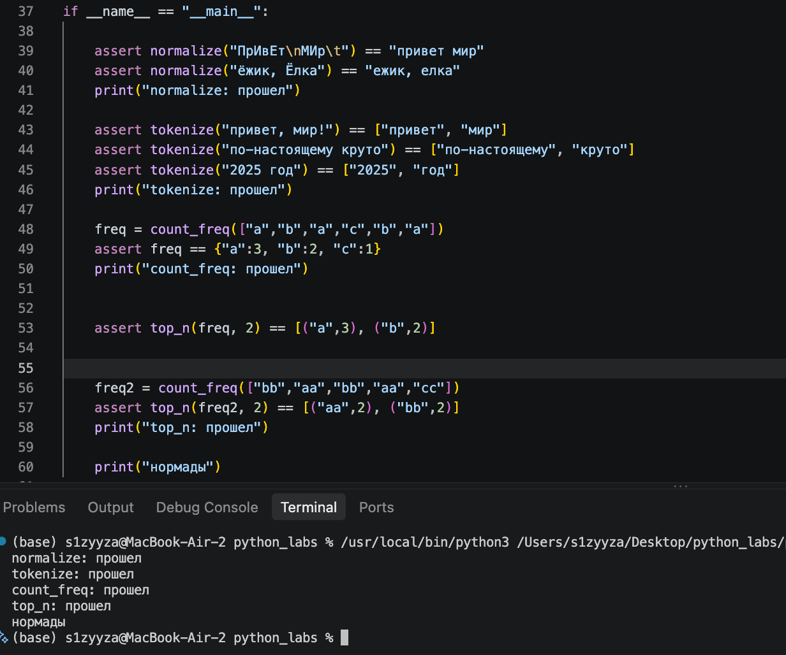
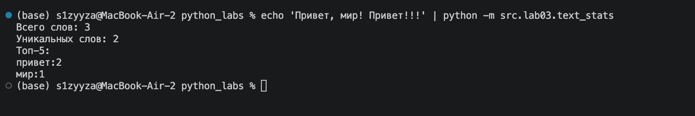

## ЛР3 — Тексты и частоты слов (словарь/множество)

### Задание 1


```python 
import re

def normalize(text: str, *, casefold: bool = True, yo2e: bool = True) -> str:
    """ Приводит текст к единому регистру, заменяет ё->е и схлопывает пробелы. """
    if casefold: 
        text = text.casefold() 
    else:
        text = text.lower() 
    if yo2e:
        text = text.replace("ё", "е").replace("Ё", "Е") 

    text = " ".join(text.split())  
    return text


def tokenize(text: str) -> list[str]:
    """ функция выделяет из текста отдельные слова с помощью регулярного выражения \w+(?:-\w+)*. """
    return re.findall(r"\w+(?:-\w+)*", text)  


def count_freq(tokens: list[str]) -> dict[str,int]:
    '''
    Подсчитывает частоты, возвращает словарь (слово, количество)
    '''
    freq = {}
    for token in tokens:
        freq[token] = freq.get(token, 0) + 1
    return freq

def top_n(freq: dict[str,int], n: int = 5) -> list[tuple[str,int]]:
    """ Возвращает топ-N по убыванию частоты; при равенстве — по алфавиту слова. """
    top = list(freq.items())
    top.sort(key=lambda x:(-x[1], x[0]))
    return top[:n]
```

ТЕСТЫ



### Задание 2

```python
import sys

from src.lib.text import normalize, tokenize, count_freq, top_n

raw_text = sys.stdin.read()
if raw_text.strip() == '':
    raise ValueError('Empty string')

clean = normalize(raw_text)
tokens = tokenize(clean)

total_w = len(tokens)
unique = len(set(tokens))

freq_dict = count_freq(tokens)
top_5 = top_n(freq_dict)

print(f'Всего слов: {total_w}')
print(f'Уникальных слов: {unique}')
print('Топ-5:')

for word, count in top_5:
    print(f'{word}:{count}')
```
ТЕСТ




