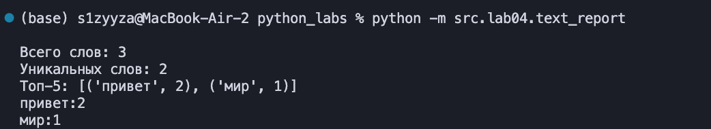
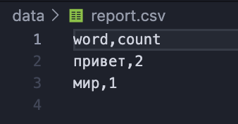
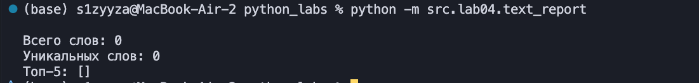
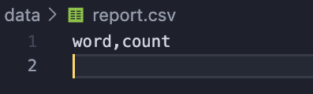
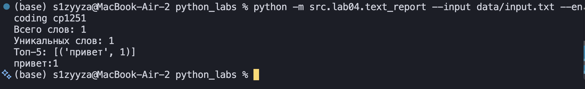

## ЛР4 —  Файлы: TXT/CSV и отчёты по текстовой статистике

### Задание 1


```python 
import csv
from pathlib import *


def read_text(path: str | Path, encoding: str = "utf-8") -> str:
    """Открывает файл целиком и возвращает весь текст одной строкой.

    Если нужна другая кодировка, укажи её так: encoding="cp1251".
    Ошибки (если файла нет или кодировка не подошла) не ловим — пусть падают.
    """
    return Path(path).read_text(encoding=encoding)


def write_csv(rows: list[tuple | list], path: str | Path,
              header: tuple[str, ...] | None = None) -> None:
    """Записывает табличку в CSV-файл через запятую.

    Если передан заголовок (header), он встает на самую первую строчку.
    Если в таблице строки разной длины — программа выдает ошибку ValueError.
    """
    rows = list(rows)
    if len({len(r) for r in rows}) > 1:
        raise ValueError("Строки в rows имеют разную длину")

    with Path(path).open("w", newline="", encoding="utf-8") as f:
        w = csv.writer(f)
        if header is not None:
            w.writerow(header)
        w.writerows(rows)
```
### Задание 2
```python
import sys
from pathlib import *

from src.lib.text import normalize, tokenize, count_freq, top_n
from src.lab04.io_txt_csv import read_text, write_csv

try:
    text = read_text("data/input.txt")
except FileNotFoundError:
    sys.exit("Ошибка: файл data/input.txt не найден")

tokens = tokenize(normalize(text))
freq = count_freq(tokens)

write_csv(top_n(freq, len(freq)), "data/report.csv", header=("word", "count"))

print(f"Всего слов: {len(tokens)}")
print(f"Уникальных слов: {len(freq)}")
print("Топ-5:", top_n(freq, 5))
for word, count in top_n(freq, 5):
        print(f"{word}:{count}")


```
ТЕСТ

ТЕРМИНАЛ



CSV



Обработка пустого файла






Тест кодировки cp1251



