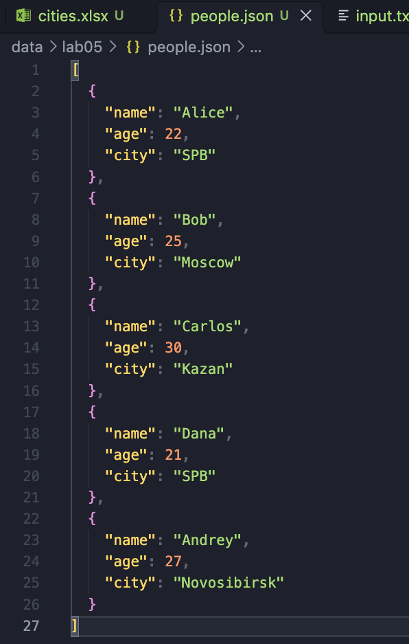
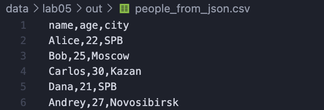
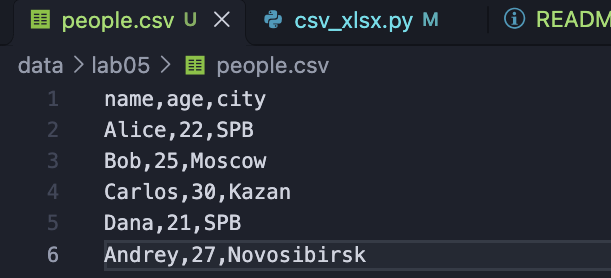
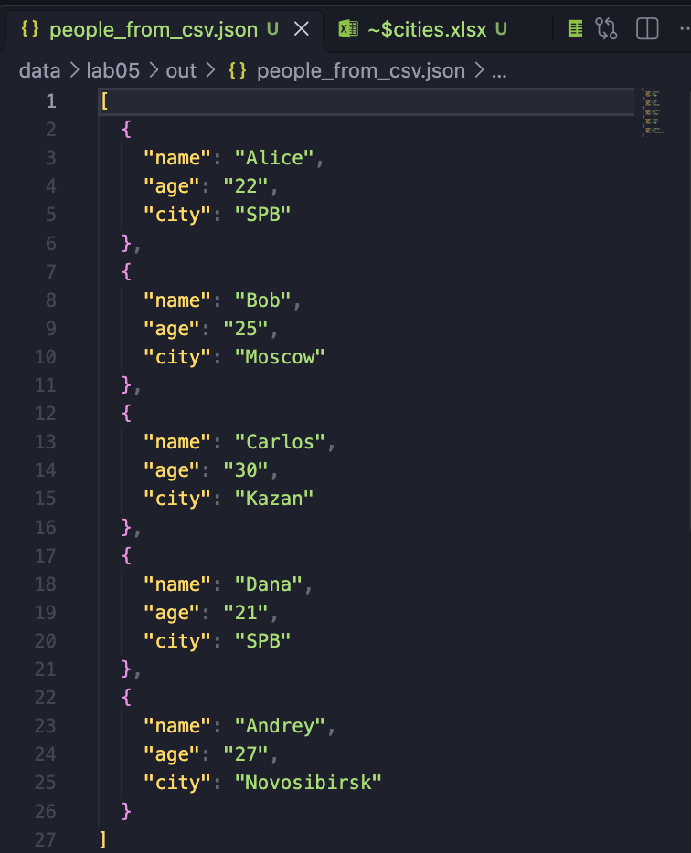
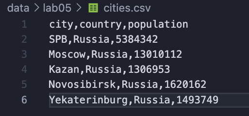
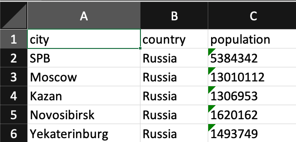

## ЛР5 — JSON и конвертации (JSON↔CSV, CSV→XLSX): 

### Задание 1

```python 
import csv
import json
from pathlib import Path


def json_to_csv(json_path: str, csv_path: str) -> None:
    """
    Преобразует JSON-файл в CSV.
    Поддерживает список словарей [{...}, {...}], заполняет отсутствующие поля пустыми строками.
    Кодировка UTF-8. Порядок колонок — как в первом объекте (с добавлением новых ключей по мере появления).
    """
    src = Path(json_path)
    dst = Path(csv_path)

    if src.suffix.lower() != ".json":
        raise ValueError(f"Ожидался файл .json, получен: {json_path}")
    if dst.suffix.lower() != ".csv":
        raise ValueError(f"Ожидался файл .csv, получен: {csv_path}")

    
    if not src.exists():
        raise FileNotFoundError(f"Файл не найден: {json_path}")


    content = src.read_text(encoding="utf-8").strip()
    if not content:
        raise ValueError("Пустой JSON или неподдерживаемая структура")

    try:
        data = json.loads(content)
    except json.JSONDecodeError as e:
        raise ValueError(f"Некорректный формат JSON: {e.msg}") from e

    
    if not isinstance(data, list) or len(data) == 0:
        raise ValueError("Пустой JSON или неподдерживаемая структура")

    if not all(isinstance(item, dict) for item in data):
        raise ValueError("Все элементы в JSON должны быть словарями (объектами)")

    
    fieldnames: list[str] = []
    for item in data:
        for key in item.keys():
            if key not in fieldnames:
                fieldnames.append(key)

    if not fieldnames:
        raise ValueError("В объектах JSON отсутствуют ключи для создания заголовка CSV")

    
    dst.parent.mkdir(parents=True, exist_ok=True)
    with dst.open("w", encoding="utf-8", newline="") as f:
        writer = csv.DictWriter(f, fieldnames=fieldnames, restval="")
        writer.writeheader()
        for row in data:
            clean_row = {k: ("" if v is None else v) for k, v in row.items()}
            writer.writerow(clean_row)


def csv_to_json(csv_path: str, json_path: str) -> None:
    """
    Преобразует CSV в JSON (список словарей).
    Заголовок обязателен, значения сохраняются как строки.
    """
    src = Path(csv_path)
    dst = Path(json_path)

    
    if src.suffix.lower() != ".csv":
        raise ValueError(f"Ожидался файл .csv, получен: {csv_path}")
    if dst.suffix.lower() != ".json":
        raise ValueError(f"Ожидался файл .json, получен: {json_path}")

    
    if not src.exists():
        raise FileNotFoundError(f"Файл не найден: {csv_path}")

   
    if src.read_text(encoding="utf-8").strip() == "":
        raise ValueError("CSV-файл пуст")

    
    with src.open("r", encoding="utf-8", newline="") as f:
        reader = csv.DictReader(f)
        if not reader.fieldnames or all(name.strip() == "" for name in reader.fieldnames):
            raise ValueError("В CSV-файле отсутствует корректный заголовок")

        rows = list(reader)

    if not rows:
        raise ValueError("CSV-файл содержит только заголовок и не имеет строк с данными")

    
    dst.parent.mkdir(parents=True, exist_ok=True)
    with dst.open("w", encoding="utf-8") as f:
        json.dump(rows, f, ensure_ascii=False, indent=2)


if __name__ == "__main__":
     
    json_to_csv("data/people.json", "data/out/people_from_json.csv")
    csv_to_json("data/people.csv", "data/out/people_from_csv.json")
```

# ТЕСТ json_to_csv

  

# ТЕСТ csv_to_json

  


### Задание 2

```python
import csv
from pathlib import Path
from openpyxl import Workbook
from openpyxl.utils import get_column_letter


def csv_to_xlsx(csv_path: str, xlsx_path: str) -> None:
    """
    Конвертирует CSV в XLSX с помощью openpyxl.
    Первая строка CSV — заголовок.
    Лист называется "Sheet1".
    Колонки — автоширина по длине текста (не менее 8 символов).
    """
    src = Path(csv_path)
    dst = Path(xlsx_path)

    
    if src.suffix.lower() != ".csv":
        raise ValueError(f"Ожидался входной файл .csv, получен: {csv_path}")
    if dst.suffix.lower() != ".xlsx":
        raise ValueError(f"Ожидался выходной файл .xlsx, получен: {xlsx_path}")

    
    if not src.exists():
        raise FileNotFoundError(f"Файл не найден: {csv_path}")

    
    if src.read_text(encoding="utf-8").strip() == "":
        raise ValueError("CSV-файл пуст")

    
    with src.open("r", encoding="utf-8", newline="") as f:
        reader = csv.reader(f)
        rows = list(reader)

    if not rows or not any(field.strip() for field in rows[0]):
        raise ValueError("CSV-файл пуст или не содержит заголовка")

    
    wb = Workbook()
    ws = wb.active
    ws.title = "Sheet1"

    for row in rows:
        ws.append(row)

    
    for col in ws.columns:
        max_len = 0
        col_letter = get_column_letter(col[0].column)
        for cell in col:
            cell_value = str(cell.value or "")
            if len(cell_value) > max_len:
                max_len = len(cell_value)
        ws.column_dimensions[col_letter].width = max(max_len + 2, 8)

    
    dst.parent.mkdir(parents=True, exist_ok=True)
    wb.save(dst)


if __name__ == "__main__":
    
    csv_to_xlsx("data/people.csv", "data/out/people.xlsx")
    csv_to_xlsx("data/cities.csv", "data/out/cities.xlsx")
```

# ТЕСТ csvtoxlsx

  