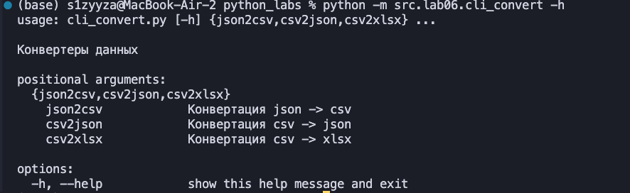
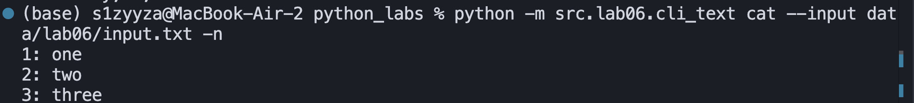
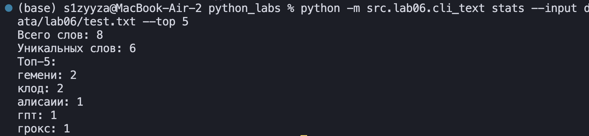
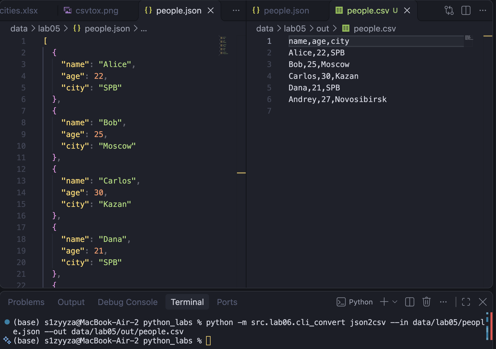
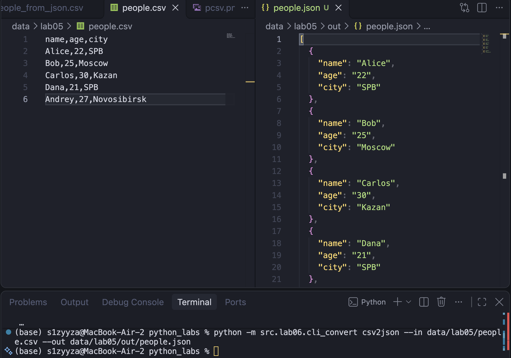
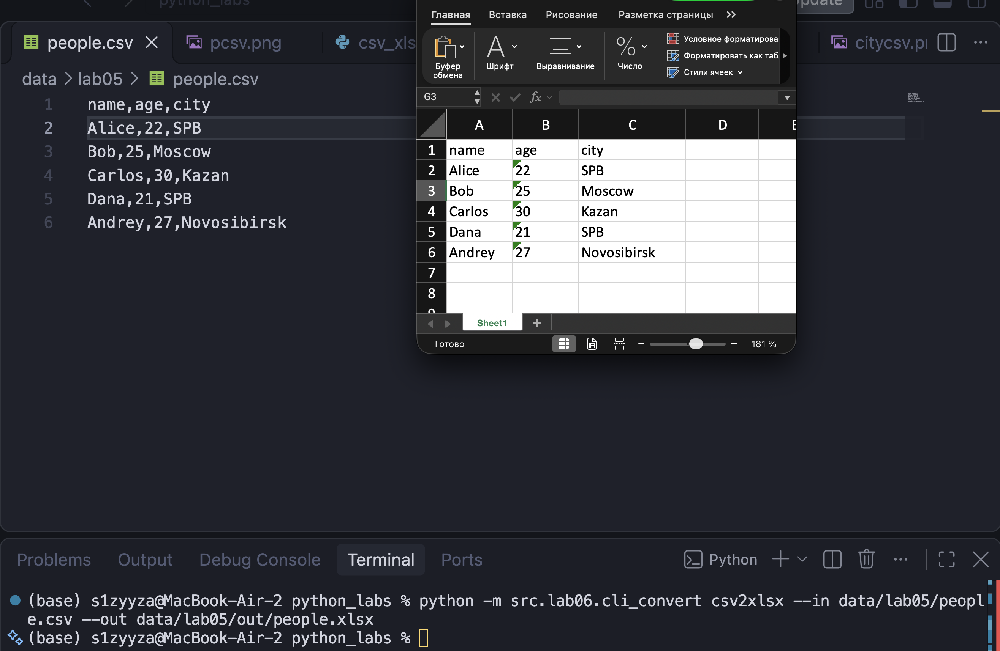

## ЛР6 — CLI‑утилиты с argparse 
Общая справка по всей программе
Чтобы посмотреть список всех доступных команд (подкоманд) и общую информацию о программе, вызовите её с флагом -h или --help:



### Задание 1 cli_text.py
#### stats --input <txt> [--top 5] — анализ частот слов в тексте (использовать функции из lab03);
#### cat --input <path> [-n] — вывод содержимого файла построчно (с нумерацией при -n).


```python
import argparse
from pathlib import Path

from src.lib.text import normalize, tokenize, count_freq, top_n


def run_cat(file_path: Path, number_lines: bool) -> None:
    """Выводит содержимое файла построчно (с нумерацией при флаге -n)."""
    if not file_path.exists():
        raise FileNotFoundError(f"Файл не найден: {file_path}")
    if not file_path.is_file():
        raise ValueError(f"Указанный путь не является файлом: {file_path}")

    with file_path.open("r", encoding="utf-8") as f:
        for idx, line in enumerate(f, start=1):
            clean_line = line.rstrip("\r\n")
            if number_lines:
                print(f"{idx}: {clean_line}")
            else:
                print(clean_line)


def run_stats(file_path: Path, top: int) -> None:
    """Считает частоты слов в файле и выводит топ-N самых частых слов."""
    if not file_path.exists():
        raise FileNotFoundError(f"Файл не найден: {file_path}")
    if not file_path.is_file():
        raise ValueError(f"Указанный путь не является файлом: {file_path}")

    with file_path.open("r", encoding="utf-8") as f:
        text = f.read()

    tokens = tokenize(normalize(text))
    freq = count_freq(tokens)
    top_words = top_n(freq, top)

    print(f"Всего слов: {len(tokens)}")
    print(f"Уникальных слов: {len(freq)}")
    print(f"Топ-{top}:")
    for word, count in top_words:
        print(f"{word}: {count}")


def main() -> None:
    parser = argparse.ArgumentParser(description="CLI‑утилиты лабораторной №6")
    subparsers = parser.add_subparsers(dest="command", required=True)

    # подкоманда stats
    stats_parser = subparsers.add_parser("stats", help="Частоты слов")
    stats_parser.add_argument("--input", required=True, type=Path, help="Путь к входному файлу")
    stats_parser.add_argument("--top", type=int, default=5, help="Количество позиций рейтинга")

    # подкоманда cat
    cat_parser = subparsers.add_parser("cat", help="Вывести содержимое файла")
    cat_parser.add_argument("--input", required=True, type=Path, help="Путь к входному файлу")
    cat_parser.add_argument("-n", action="store_true", help="Нумеровать строки")

    args = parser.parse_args()

    if args.command == "stats":
        run_stats(args.input, args.top)
    elif args.command == "cat":
        run_cat(args.input, args.n)


if __name__ == "__main__":
    main()
```

# ТЕСТ 




### Задание 2
#### Модуль src/lab06/cli_convert.py с подкомандами:
#### json2csv --in data/samples/people.json --out data/out/people.csv
#### csv2json --in data/samples/people.csv --out data/out/people.json
#### csv2xlsx --in data/samples/people.csv --out data/out/people.xlsx
#### (использовать функции из lab05)

# json2csv

# csv2json 

# csv2xlsx 

